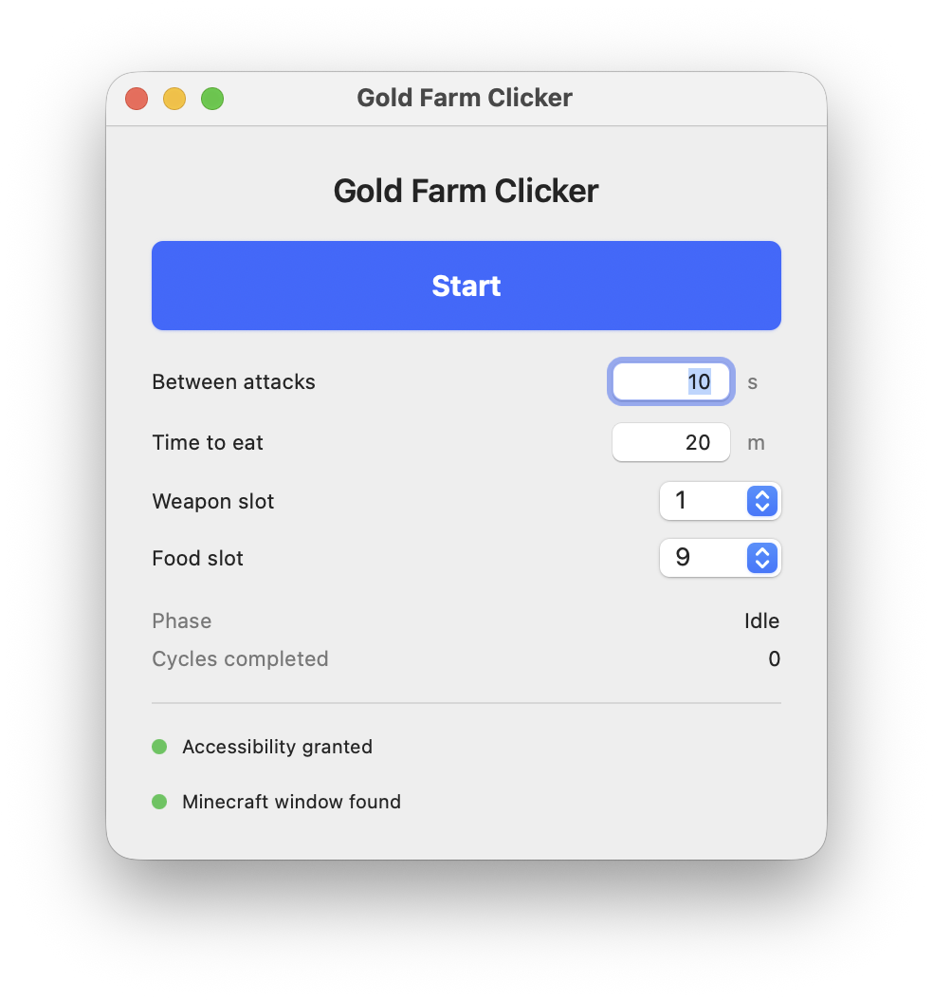

# Gold Farm Clicker

A small macOS app that auto-clicks a Minecraft gold farm and periodically eats food from a hotbar slot.

For a Windows version, see [@chromeeh](https://github.com/chromeeh).



## What it does

1. Left-clicks the Minecraft window on a configurable interval (default 10 seconds), usually a weapon slot.
2. After a configurable attack duration (default 20 minutes), selects the food hotbar slot, holds right-click for 10 seconds (eat), then selects the weapon slot again.
3. Repeats until you press **Stop**.

Settings (interval, time-to-eat, weapon/food slots) are editable while stopped and are remembered between launches.

## Build

Requires macOS 14+ and Xcode Command Line Tools (or Xcode).

```bash
./build.sh
open build/GoldFarmClicker.app
```

Or open `Package.swift` in Xcode and run the `GoldFarmClicker` scheme from there. Prefer the `.app` from `build.sh` for Accessibility permissions (stable path).

## Accessibility permission

The app posts mouse and keyboard events to Minecraft, so macOS requires Accessibility access:

1. Launch `build/GoldFarmClicker.app`.
2. Press **Start** (or **Open Settings** in the app).
3. In **System Settings → Privacy & Security → Accessibility**, enable **Gold Farm Clicker**.

### Rebuild caveat

This project is ad-hoc signed. Each rebuild produces a new code signature, so macOS may treat it as a different app. After rebuilding:

1. Open **System Settings → Privacy & Security → Accessibility**.
2. Remove the old **Gold Farm Clicker** entry (−).
3. Re-add / enable the newly built `build/GoldFarmClicker.app`.

Keeping the app at the same path (`build/GoldFarmClicker.app`) avoids duplicate clutter.

## Usage tips

- Be in-game (not in a menu/inventory) when you press **Start**.
- Put your sword in hotbar slot **1** and food in slot **9**.
- The clicker activates the Minecraft window before each input, so Minecraft stays frontmost during the run.
- Single-player worlds pause when Minecraft loses focus; stay in the game (or disable pause-on-lost-focus with F3+P).
- Detection looks for a Java process whose executable lives under a `minecraft` path (official launcher), or a window/owner named Minecraft. Window titles alone are unreliable on modern macOS.

## Debug

Shorten the attack phase for testing:

```bash
GFC_ATTACK_SECONDS=30 open build/GoldFarmClicker.app
```

That value is the total attack-phase duration in seconds (default `1200` = 20 minutes) before an eat cycle.
